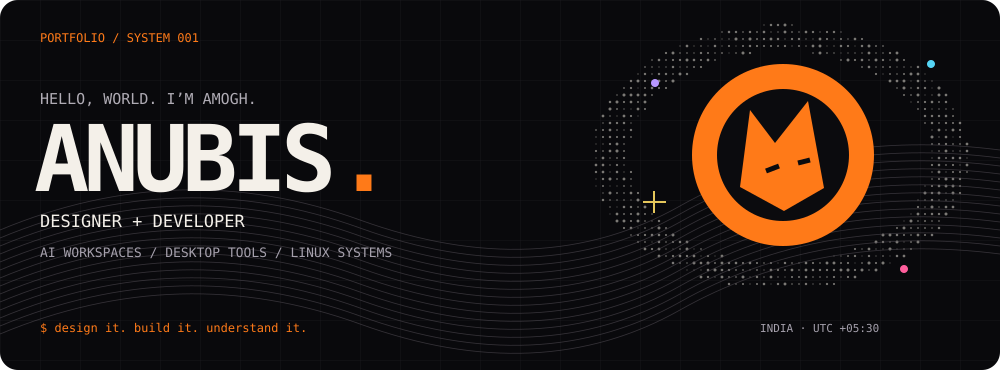
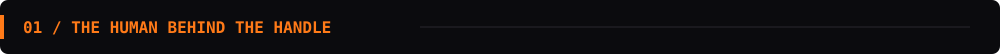
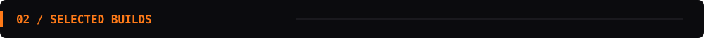
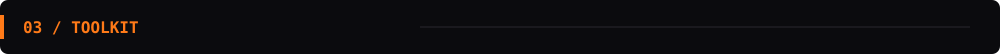
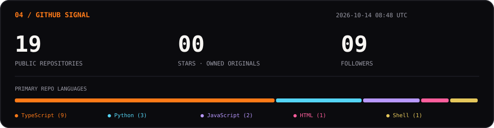

  
    
  
  
  
    
  <samp>Good software should feel as good as it works.</samp>

 

<table>
<tr>
<td width="50%"><samp>NAME</samp> <b>Amogh Sharma</b></td>
<td width="50%"><samp>HOME BASE</samp> <b>CSE · Bennett University · India</b></td>
</tr>
<tr>
<td><samp>BUILDING</samp> <b>Local AI · Native tools · CLI</b></td>
<td><samp>EXPLORING</samp> <b>Rust · Retrieval · Linux internals</b></td>
</tr>
</table>

 

<table>
<tr>
<td width="33%" valign="top">
<samp>01 / COGNITIVE WORKSPACE</samp>
<h3><a href="https://github.com/AmoghxAnubis/Synapse">SYNAPSE ↗</a></h3>

Documents → searchable memory.

<code>Next.js</code> <code>FastAPI</code> <code>ONNX</code>

</td>
<td width="33%" valign="top">
<samp>02 / WINDOWS OVERLAY</samp>
<h3><a href="https://github.com/AmoghxAnubis/PILL">PILL ↗</a></h3>

Media. Telemetry. Focus.

<code>Tauri</code> <code>Rust</code> <code>React</code>

</td>
<td width="33%" valign="top">
<samp>03 / DISK INVESTIGATOR</samp>
<h3><a href="https://github.com/AmoghxAnubis/ghost">GHOST ↗</a></h3>

Find what’s eating your storage.

<code>Bash</code> <code>Linux</code> <code>SHA-256</code>

</td>
</tr>
</table>

<samp>↳ MORE FROM THE LAB</samp>

 

<code>Element</code> controller-driven Linux control plane · <code>SentinelCI</code> test intelligence · <code>KernelNotes</code> developer knowledge base · <code>Eunoia</code> mental wellness · <code>NeuroCredit</code> identity · <code>memOS</code> memory API

 

<table>
<tr>
<td width="140"><samp>LANGUAGES</samp></td>
<td>

</td>
</tr>
<tr>
<td width="140"><samp>WEB + NATIVE</samp></td>
<td>

</td>
</tr>
<tr>
<td width="140"><samp>AI + VISION</samp></td>
<td>

  

</td>
</tr>
<tr>
<td width="140"><samp>DATA</samp></td>
<td>

  

</td>
</tr>
<tr>
<td width="140"><samp>INFRA + TOOLS</samp></td>
<td>

</td>
</tr>
<tr>
<td width="140"><samp>DESIGN</samp></td>
<td>

  

</td>
</tr>
</table>

<samp>LOADING NEXT →</samp>
<code>Rust</code>
<code>Kubernetes</code>
<code>GCP</code>
<code>Linux internals</code>

 

  

<samp>DESIGN WITH INTENT. BUILD WITH CURIOSITY.</samp>
  
<a href="https://anubis-portfolio.vercel.app/">Portfolio ↗</a>
&nbsp; / &nbsp;
<a href="https://github.com/AmoghxAnubis?tab=repositories">Explore the builds ↗</a>

